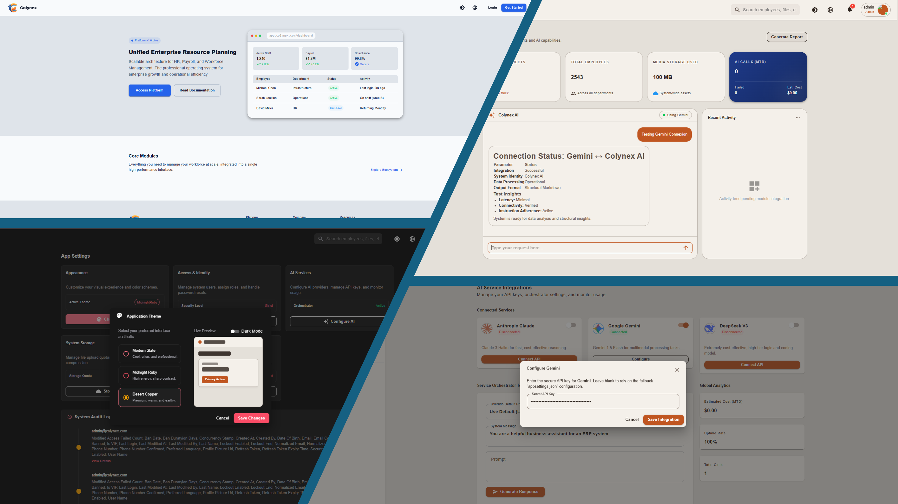
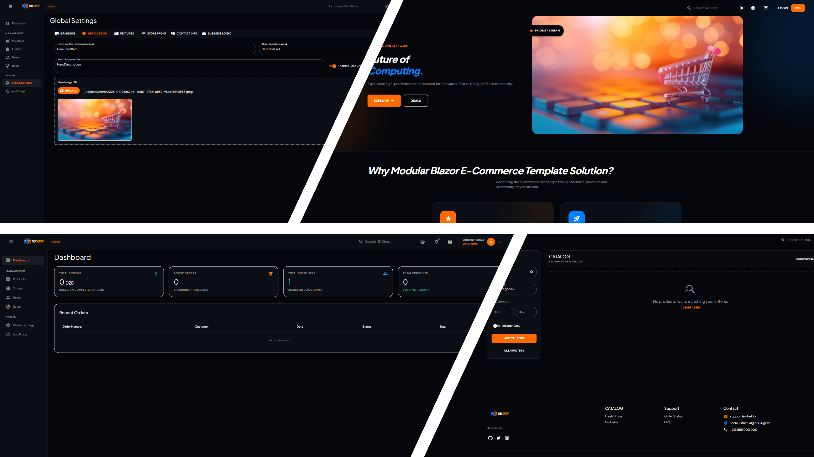

# Hi there, I'm SADOUKI Aimen (Mr.Greullr) 👋

I am a **Full-Stack .NET & React Developer** with a focus on **rapid prototyping**, building functional MVPs, and transforming complex business workflows into clean, interactive web applications. I enjoy experimenting with modern web technologies across the **.NET 10 / C#** and **React 19 / TypeScript** ecosystems.

> 🎖️ **Accreditation:** Author of **Colynex**, officially certified as an **Innovative Project** (*مشروع مبتكر*) by the Algerian Ministry of Knowledge Economy, Startups and Micro-enterprises.

---

## 🚀 Featured Projects

### 1. Colynex *(In Active Development)*
**Live Demo:** [colynex.runasp.net](https://colynex.runasp.net/)  
*Accredited Innovative Project — Algerian Ministry of Knowledge Economy, Startups & Micro-enterprises*

  

Colynex is currently in active development as a complete, modernized re-architecture of my earlier prototype, [**C-HR-Manager**](https://github.com/MrGreullr/C-HR-Manager/). It explores clean, modular application structure to handle operational administration, HR, and regulatory calculations.
* **Tech Stack:** .NET 10 (C# Minimal APIs), Entity Framework Core 10, React 19 (TypeScript, Tailwind CSS 4, shadcn/ui), SignalR, SQL Server & PostgreSQL.
* **Algerian Payroll & Labor Compliance:** Re-engineered the labor compliance prototype into an exact statutory payroll engine (Loi 90-11, progressive IRG 2026 scale, CNAS) with a binary search **Reverse Salary Calculator** (Net-to-Gross) converging in $\le 25$ iterations.
* **Architecture & Security Exploration:** Features FIDO2/WebAuthn hardware key authentication, AES-256 column encryption, outbox pattern auditing, and biometric clock punch simulation.
* **Testing:** Backed by 145 automated xUnit tests validating calculation accuracy and domain logic.

---

### 2. Project Ofok (Promotion Immobilière El-Ofok)
*Luxury Architectural Showcase & Residence Explorer*

  

A digital vitrine and property catalog developed for **Promotion Immobilière El-Ofok** (real estate developer in Algiers) to showcase high-standing residential developments such as *Résidence Oumniya*.
* **Tech Stack:** .NET 10 (Minimal APIs), Entity Framework Core 10, React 19 (TypeScript, Vite, Tailwind CSS 4), Zustand, PostgreSQL, Docker.
* **Key Features:**
  * **Dynamic Stacking Plan & Blueprint Inspector:** Interactive floor-level slicer and room distribution inspector with clickable hot-spots.
  * **Commercial WhatsApp Concierge:** Direct one-click inquiry links pre-populated with apartment typology, surface area, and residence details.
  * **Trilingual Localization:** French (default), Arabic with native RTL directionality (`dir="rtl"`), and English.
  * **Testing:** 153 passing automated xUnit tests covering catalog services, domain rules, and security policies.

---

### 3. MBET (Modular Blazor E-Commerce Template) Prototype
**Live Demo:** [ndshop.runasp.net](https://ndshop.runasp.net/) | **Source Code:** [GitHub Repository](https://github.com/MrGreullr/MBET_Prototype/)

  

A prototype e-commerce application built to explore responsive UI components, state management, and multi-database compatibility in Blazor.
* **Tech Stack:** C#, .NET, Blazor Server, Entity Framework Core.
* **Dynamic Database Switching:** Configurable database provider layer allowing seamless switching between **SQL Server** and **PostgreSQL** via `appsettings.json` without code modifications.

---

## 🛠️ Technical Skills & Tools

| Area | Technologies |
| :--- | :--- |
| **Backend Development** | **C#**, **.NET 10**, ASP.NET Core (Minimal APIs), Clean Architecture concepts, Outbox Pattern |
| **Frontend Development** | **React 19**, **TypeScript**, Vite, **Tailwind CSS 4**, shadcn/ui, Blazor, Multilingual / RTL (Arabic, French, English) |
| **Data & Databases** | **Entity Framework Core 10**, PostgreSQL, SQL Server, SQLite |
| **Testing & Quality** | **xUnit**, FluentAssertions, Integration & Unit Testing |
| **Tools & Deployment** | Git, GitHub, Docker, Dokploy, IIS / MonsterASP, PowerShell |

---

## 📫 Let's Connect

* **LinkedIn:** [Aimen Sadouki](https://www.linkedin.com/in/aimen-sadouki)
* **Email:** [sadoukiaimen@gmail.com](mailto:sadoukiaimen@gmail.com)
* **Resume:** [Download Resume PDF 📥](https://drive.google.com/file/d/1M3RgCHnetHVsHkqHzkhQd6NGlnrpXSwj/view?usp=sharing)
